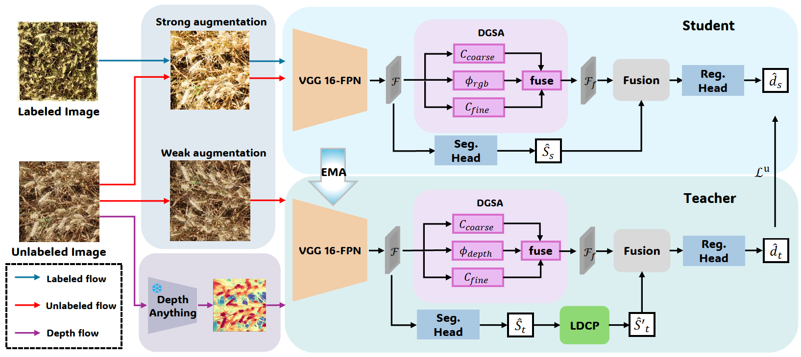

# DPGC: Depth-Prior Guided Semi-Supervised Wheat Ear Counting

Our paper has been accepted to MMM 2027.

## Abstract

Semi-supervised counting reduces the dependence on dense
annotations by exploiting unlabeled images, which is particularly valu-
able for in-field wheat ear counting. However, perspective-induced scale
variation and unreliable pseudo supervision remain major challenges in
dense and complex field scenes. To address these issues, we propose
DPGC, a depth-prior-guided semi-supervised framework that leverages
monocular depth as a training-time geometric prior. At the represen-
tation level, Depth-Guided Scale Attention Distillation transfers depth-
aware scale selection knowledge from the depth branch to an RGB-only
student, enabling geometry-aware adaptation to spatial scale variations.
At the supervision level, Local Depth Consistency Purification refines
teacher-generated segmentation pseudo-labels using local depth affinity,
thereby suppressing geometrically inconsistent supervision. The depth
encoder is discarded after training, and inference requires only RGB im-
ages without depth estimation or additional sensing modalities. Experi-
ments on two wheat ear datasets under multiple annotation budgets con-
sistently demonstrate the effectiveness of the proposed geometry-guided
semi-supervised counting framework.

## Framework



## Usage

### Environment

Create a Python environment and install the required packages:

```bash
conda create -n dpgc python=3.9 -y
conda activate dpgc

pip install torch torchvision
pip install numpy scipy scikit-image opencv-python matplotlib h5py
```

Install a PyTorch build compatible with the CUDA version on your machine.

### Repository structure

```text
DPGC/
├── Network/
│   ├── CountNet.py
│   ├── mean_teacher_model.py
│   ├── base_Network_module.py
│   ├── class_func.py
│   └── search_template.py
├── cls_funcs/
│   └── Interval_paritition.py
├── label_list/
│   ├── GWHD5.txt
│   ├── GWHD10.txt
│   ├── GWHD40.txt
│   ├── DNW5.txt
│   ├── DNW10.txt
│   └── DNW40.txt
├── models/
│   └── depth_anything_v2/
├── utils/
│   ├── IOtools.py
│   ├── load_data_V2.py
│   ├── semi_supervised_dataset.py
│   └── visualization.py
├── checkpoints/                 # Not included in the repository
├── data/                        # Not included in the repository
├── outputs/                     # Generated during training
├── train.py
├── THIRD_PARTY_NOTICE.md
└── README.md
```

### Dataset

Organize the datasets as follows:

```text
data/
├── GWHD2021/
│   ├── train/
│   │   ├── images/
│   │   └── gtdens/
│   ├── val/
│   │   ├── images/
│   │   └── gtdens/
│   └── test/
│       ├── images/
│       └── gtdens/
└── DNW/
    ├── train/
    │   ├── images/
    │   └── gtdens/
    ├── val/
    │   ├── images/
    │   └── gtdens/
    └── test/
        ├── images/
        └── gtdens/
```

Each annotation file in `gtdens/` must have the same base filename as its corresponding image. The annotation files are expected to contain the arrays required by the current data loader, including:

```text
dot_map
density_map
seg_map
```

The labeled-image lists are stored separately in the repository-level `label_list/` directory. Each text file contains one labeled image filename per line:

```text
0001.jpg
0037.jpg
0125.jpg
```

The datasets are not included in this repository.

- GWHD2021: [Official Global Wheat Dataset page](https://www.global-wheat.com/gwhd.html)
- DNW: public dataset access and license information should be provided with the released code.

### Pretrained depth weights

Download the Depth Anything V2 relative-depth checkpoint from the official repository:

- [Depth Anything V2 repository and pretrained models](https://github.com/DepthAnything/Depth-Anything-V2#pre-trained-models)

Place the selected checkpoint in `checkpoints/`:

```text
checkpoints/
├── depth_anything_v2_vits.pth
├── depth_anything_v2_vitb.pth
└── depth_anything_v2_vitl.pth
```

The value of `--depth-encoder` must match the downloaded checkpoint:

| Checkpoint | Argument |
|---|---|
| `depth_anything_v2_vits.pth` | `--depth-encoder vits` |
| `depth_anything_v2_vitb.pth` | `--depth-encoder vitb` |
| `depth_anything_v2_vitl.pth` | `--depth-encoder vitl` |

The experiments reported in the paper use Depth Anything V2-Large:

```text
--depth-encoder vitl
--depth-weights ./checkpoints/depth_anything_v2_vitl.pth
```

The pretrained models could be downloaded from : https://pan.baidu.com/s/1FareXddufTkEinb79rtzow?pwd=kba2. extraction code: kba2. Please test the pre-trained model on the images pre-processed with our code.

## Training

The following commands reproduce the main settings reported in the paper:

- 300 training epochs;
- batch size of 16;
- initial learning rate of `1e-5`;
- weight decay of `5e-4`;
- 30 supervised warm-up epochs;
- LDCP enabled from epoch 150;
- LDCP radius `r = 3`;
- DGSA dilation rate of 2;
- route-distillation weight of 0.2;
- feature-distillation weight of 0.5;
- residual coefficient initialized to 0.2 and capped at 0.5.

### GWHD2021 with 5% labeled data

```bash
python train.py \
  --sdset GWHD2021 \
  --dataroot ./data/GWHD2021 \
  --labeled-list ./label_list/GWHD5.txt \
  --labeled-ratio 0.05 \
  --num-labeled 2 \
  --crop-size 512 \
  --bs 16 \
  --lr 1e-5 \
  --weight-decay 5e-4 \
  --epoch-num 300 \
  --warmup-epochs 30 \
  --ema-decay 0.99 \
  --ldcp-start-epoch 150 \
  --ldcp-r 3 \
  --ldcp-sigma 0.6 \
  --ldcp-seg-weight 0.5 \
  --dgsa-dilation 2 \
  --lambda-route 0.2 \
  --lambda-feat 0.5 \
  --dgsa-alpha-init 0.2 \
  --dgsa-alpha-max 0.5 \
  --depth-encoder vitl \
  --depth-weights ./checkpoints/depth_anything_v2_vitl.pth \
  --save-dir ./outputs \
  --device 0
```

```bash
python train.py --help
```

## Resume training

```bash
python train.py \
  --sdset GWHD2021 \
  --dataroot ./data/GWHD2021 \
  --labeled-list ./label_list/GWHD5.txt \
  --labeled-ratio 0.05 \
  --num-labeled 2 \
  --bs 16 \
  --lr 1e-5 \
  --ema-decay 0.99 \
  --depth-encoder vitl \
  --depth-weights ./checkpoints/depth_anything_v2_vitl.pth \
  --save-dir ./outputs \
  --resume ./outputs/semi_GWHD2021_lr1e-05_bs16_labeled0.05_ema0.99/checkpoint_latest.pth \
  --device 0
```

## Evaluation

A separate `test.py` is not used. Evaluation is performed through:

```bash
python train.py --test-only
```

### Configure the checkpoint

The current `test()` method loads the student checkpoint through:

```python
def test(self):
    """Evaluate the student model on the test split."""
    # Load the selected student checkpoint.
    best_student_path = os.path.join(self.save_dir, "best_student.pth")
```

Place the checkpoint inside the experiment directory generated from the command-line settings. For example, with:

```text
--save-dir ./outputs
--sdset GWHD2021
--lr 1e-5
--bs 16
--labeled-ratio 0.05
--ema-decay 0.99
```

the resolved experiment directory is:

```text
./outputs/semi_GWHD2021_lr1e-05_bs16_labeled0.05_ema0.99/
```

Therefore, the default checkpoint path is:

```text
./outputs/semi_GWHD2021_lr1e-05_bs16_labeled0.05_ema0.99/best_student.pth
```

Do not hard-code a local absolute path containing a username or server directory. Use a checkpoint filename relative to `self.save_dir`, such as:

```python
best_student_path = os.path.join(self.save_dir, "best_student.pth")
```

### Evaluate GWHD2021 with the 5% setting

The test command must use the same dataset, learning rate, batch size, labeled ratio, EMA decay, and output root that were used to construct the training experiment directory:

```bash
python train.py \
  --test-only \
  --sdset GWHD2021 \
  --dataroot ./data/GWHD2021 \
  --labeled-list ./label_list/GWHD5.txt \
  --labeled-ratio 0.05 \
  --num-labeled 2 \
  --bs 16 \
  --lr 1e-5 \
  --ema-decay 0.99 \
  --depth-encoder vitl \
  --depth-weights ./checkpoints/depth_anything_v2_vitl.pth \
  --save-dir ./outputs \
  --device 0
```

The test split is read from:

```text
./data/GWHD2021/test/
```

The current evaluation code reports the following counting metrics:

```text
MAE
RMSE
```

The implementation computes RMSE as:

```python
rmse = np.sqrt(np.mean(np.square(errors)))
```

For consistency with the paper, use the variable and output label `RMSE` rather than `MSE`.

## Outputs

Training and evaluation files are saved under:

```text
outputs/
└── semi_<dataset>_lr<lr>_bs<batch-size>_labeled<ratio>_ema<decay>/
    ├── best_student.pth
    ├── checkpoint_latest.pth
    ├── checkpoint_epoch*.pth
    ├── train.log
    ├── test_results.txt
    └── visualizations/
```

## Citation

Citation information will be added upon official publication.

```bibtex
@inproceedings{zheng2027dpgc,
  title     = {DPGC: Depth-Prior Guided Semi-Supervised Wheat Ear Counting},
  author    = {Chaofan Zheng, Yuchen Zhang and Hualei Shen},
  booktitle = {International Conference on Multimedia Modeling},
  year      = {2027}
}
```

## Acknowledgements

This repository contains adapted components from [Depth Anything V2](https://github.com/DepthAnything/Depth-Anything-V2). The original license and attribution are retained under `models/depth_anything_v2/` and in `THIRD_PARTY_NOTICE.md`.
